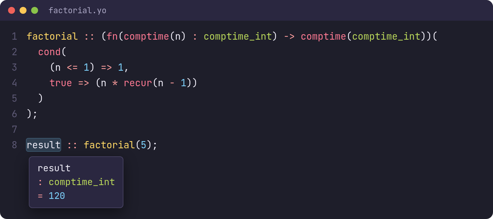

# Yo


**English** | [简体中文](./docs/zh-CN/README.md)

**Work in Progress :) Not Ready!**

https://shd101wyy.github.io/Yo

**Written by models. Checked by the compiler. Read by people.**

Yo is a compiled systems language designed for LLMs to write safe, correct and
fast programs, and for people to read them. It compiles to C11 and lets your C
compiler finish the job. The compiler is written in Yo and builds itself.


The name comes from `柚` (yòu), the pomelo, and is my daughter's nickname. The
mascot is Youyou (柚柚), a panda hugging a halved pomelo.

<br clear="right" />

## Features

- [Ownership and borrowing](./docs/en-US/OWNERSHIP_AND_BORROWING.md) — values by default: one owner, a move at the last use, an explicit `.clone()`; `&T`/`&mut T` references whose types carry their origin, checked at compile time like Rust's borrow checker; `Rc`/`Arc` for explicit sharing.
- [Memory safety by default](./docs/en-US/MEMORY_SAFETY.md) — raw pointers, FFI and inline assembly need `pragma(Pragma.AllowUnsafe);`; `yo unsafe-report` lists the unsafe surface.
- [Explicit allocators](./docs/en-US/EXPLICIT_ALLOCATORS.md) — a global allocator by default, or one argument at the creation site.
- [Formal verification](./docs/en-US/FORMAL_VERIFICATION.md) — `requires`/`ensures` contracts and refinement types proved at compile time by Z3 (`yo verify`), with a counter-example when one fails.
- [Compile-time evaluation](./docs/en-US/CTFE.md) — first-class types, and functions with `comptime` parameters run in the compiler.
- [Algebraic effects](./docs/en-US/ALGEBRAIC_EFFECTS.md) and [async/await](./docs/en-US/ASYNC_AWAIT.md) — one-shot effect handlers; async is the builtin `Io` effect on a single-threaded event loop.
- [Parallelism](./docs/en-US/PARALLELISM.md) — a thread-per-core runtime, separate from async.
- [C interop](./docs/en-US/FFI.md) — `c_include(...)` and `extern(...)` bind C headers and symbols.
- [One way to write each thing](./docs/en-US/GRAMMAR.md) — no operator precedence, no function overloading.
- [Build system and packages](./docs/en-US/BUILD_SYSTEM.md) — `yo init`, `yo build`, dependencies in `yo.toml`, [WebAssembly](./docs/en-US/WASM.md) targets.
- [Tooling for agents](./docs/en-US/CONTEXT.md) — `yo context` (the language guide for the installed version), coded [diagnostics](./docs/en-US/ERROR_DIAGNOSTICS.md) with `yo explain` and `yo fix`.
- [Language server](./docs/en-US/LSP.md) — `yo lsp`, used by the [VS Code extension](https://marketplace.visualstudio.com/items?itemName=shd101wyy.yolang).



## Installation

```bash
# macOS / Linux
curl -sSL https://shd101wyy.github.io/Yo/install.sh | sh
```

```powershell
# Windows (PowerShell)
irm https://shd101wyy.github.io/Yo/install.ps1 | iex
```

The script installs a prebuilt compiler (under `~/.local`, or
`%LOCALAPPDATA%\Yo` on Windows), plus clang and git if they are missing.
`curl -sSL https://shd101wyy.github.io/Yo/install.sh | sh -s -- --help` lists
its options: a specific `--version`, a `--prefix`, or `--from-source` on
platforms without a prebuilt bundle (NixOS, Alpine). Manual setup:
[Linux](./docs/en-US/INSTALL_LINUX.md), [macOS](./docs/en-US/INSTALL_MACOS.md),
[Windows](./docs/en-US/INSTALL_WINDOWS.md),
[WebAssembly](./docs/en-US/INSTALL_WASM.md).

### Install with an agent

Paste this into Claude Code, Codex, Cursor or another coding agent:

```text
Install the Yo programming language (https://github.com/shd101wyy/Yo) with its official installer:
  macOS/Linux:          curl -sSL https://shd101wyy.github.io/Yo/install.sh | sh
  Windows (PowerShell): irm https://shd101wyy.github.io/Yo/install.ps1 | iex
If it needs sudo to install system packages, ask me. Then make sure `yo` is on my PATH and `yo --version` works.
Before writing any Yo code, run `yo context` and read all of it: it is the language guide for the installed version.
```

The agent installs Yo and loads the language guide that matches the installed
compiler, which it needs because Yo is not in its training data.

## Quick start

```bash
yo init my-project
cd my-project
yo build run          # prints: Hello, world!
```

`yo init` writes a manifest (`yo.toml`), a `build.yo`, sources, tests, and an
`AGENTS.md`/`CLAUDE.md` that point coding agents at `yo context`. The entry
point, `src/main.yo`:

```yo
{ println } :: import("std/fmt");

main :: (fn() -> unit)({
  println("Hello, world!");
});

export(main);
```

`yo build test` runs the tests, `yo fmt` formats, `yo --help` lists every
command. `yo --lang zh-CN` (or `YO_LANG=zh-CN`) switches the CLI to Simplified
Chinese.

## Documentation

- [Language design](./docs/en-US/DESIGN.md)
- [Standard library reference](https://shd101wyy.github.io/Yo/std)
- [Version pinning](./docs/en-US/VERSION_MANAGEMENT.md) with `.yo-version`
- Editors: [LSP setup](./docs/en-US/LSP.md); Vim/Neovim syntax in [vscode-extension/syntaxes](./vscode-extension/syntaxes/README.md)
- Examples: [raylib-yo](https://github.com/shd101wyy/raylib-yo), [tetris-yo](https://github.com/shd101wyy/tetris-yo) ([play](https://shd101wyy.github.io/tetris-yo/)), [http-server-demo-yo](https://github.com/shd101wyy/http-server-demo-yo), [markdown-it-yo](https://github.com/shd101wyy/markdown-it-yo), [markdown-yo](https://github.com/shd101wyy/markdown-yo) ([try it](https://shd101wyy.github.io/markdown-yo/))
- [My story with programming languages](./docs/en-US/MY_STORY_WITH_PROGRAMMING_LANGUAGES.md)

## Contributing

See [CONTRIBUTING.md](./CONTRIBUTING.md) for the dev environment, the build
loop and the test suites. LLM-assisted contributions are welcome.

## License

[Apache License 2.0 with LLVM Exceptions](./LICENSE.md)
