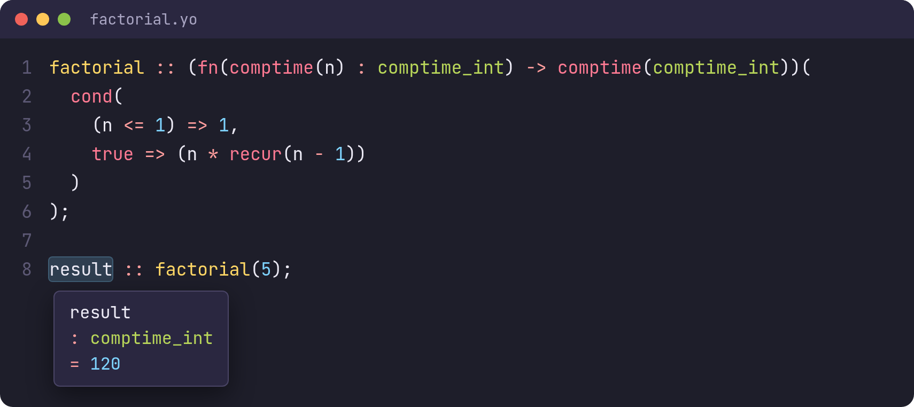

# Yo


[English](../../README.md) | **简体中文**

**开发中 :) 尚未就绪！**

https://shd101wyy.github.io/Yo

**模型来写，编译器来查，人来读。**

Yo 是一门编译型系统编程语言，其设计目标是让 LLM 写出安全、正确、快速的程序，并让人读得懂。
它编译为 C11，由你的 C 编译器完成剩下的工作。编译器本身用 Yo 编写，并能自举。


名字来自 `柚`（yòu），即柚子，也是我女儿的小名。吉祥物是柚柚（Youyou），一只抱着半个柚子的熊猫。

<br clear="right" />

## 特性

- [所有权与借用](./OWNERSHIP_AND_BORROWING.md) —— 默认是值：一个所有者，最后一次使用时移动，拷贝要显式写 `.clone()`；`&T`/`&mut T` 引用的类型带有它的来源，像 Rust 的借用检查器一样在编译期检查；共享用 `Rc`/`Arc` 显式表达。
- [默认内存安全](./MEMORY_SAFETY.md) —— 裸指针、FFI 和内联汇编需要 `pragma(Pragma.AllowUnsafe);`；`yo unsafe-report` 列出 unsafe 表面。
- [显式分配器](./EXPLICIT_ALLOCATORS.md) —— 默认使用全局分配器，也可以在创建处传一个参数指定。
- [形式化验证](./FORMAL_VERIFICATION.md) —— `requires`/`ensures` 契约与精化类型在编译期由 Z3 证明（`yo verify`），不成立时给出反例。
- [编译期求值](./CTFE.md) —— 类型是一等值，带 `comptime` 参数的函数在编译器中运行。
- [显式能力](./ALGEBRAIC_EFFECTS.md)与 [async/await](./ASYNC_AWAIT.md) —— I/O、内存分配与失败都是使用它们的函数的参数；async 是编译器基于 `Io` 做的变换，运行在单线程事件循环上。
- [并行](./PARALLELISM.md) —— 线程与自有工作线程的线程池，每个线程一个事件循环，与 async 相互独立。
- [C 互操作](./FFI.md) —— `c_include(...)` 与 `extern(...)` 绑定 C 头文件和符号。
- [每件事只有一种写法](./GRAMMAR.md) —— 没有运算符优先级，没有函数重载。
- [构建系统与包管理](./BUILD_SYSTEM.md) —— `yo init`、`yo build`，依赖写在 `yo.toml` 中，支持 [WebAssembly](./WASM.md) 目标。
- [面向智能体的工具](./CONTEXT.md) —— `yo context`（与已安装版本一致的语言指南），带编号的[诊断](./ERROR_DIAGNOSTICS.md)，以及 `yo explain` 和 `yo fix`。
- [语言服务器](./LSP.md) —— `yo lsp`，[VS Code 扩展](https://marketplace.visualstudio.com/items?itemName=shd101wyy.yolang)使用它。



## 安装

```bash
# macOS / Linux
curl -sSL https://shd101wyy.github.io/Yo/install.sh | sh
```

```powershell
# Windows（PowerShell）
irm https://shd101wyy.github.io/Yo/install.ps1 | iex
```

脚本安装预编译的编译器（位于 `~/.local`，Windows 上为 `%LOCALAPPDATA%\Yo`），缺少
clang 和 git 时一并安装。`curl -sSL https://shd101wyy.github.io/Yo/install.sh | sh -s -- --help`
列出全部选项：指定版本 `--version`、安装前缀 `--prefix`，以及在没有预编译包的平台（NixOS、Alpine）上使用的
`--from-source`。手动配置 C 工具链、升级与 WebAssembly：[INSTALL.md](./INSTALL.md)。

### 让智能体安装

把下面这段话粘贴给 Claude Code、Codex、Cursor 或其他编程智能体：

```text
用官方安装脚本安装 Yo 编程语言（https://github.com/shd101wyy/Yo）：
  macOS/Linux:          curl -sSL https://shd101wyy.github.io/Yo/install.sh | sh
  Windows (PowerShell): irm https://shd101wyy.github.io/Yo/install.ps1 | iex
如果需要 sudo 安装系统软件包，先问我。然后确认 `yo` 在我的 PATH 中，并且 `yo --version` 能运行。
写任何 Yo 代码之前，先运行 `yo context` 并完整阅读输出：它是与所安装版本一致的语言指南。
```

智能体会安装 Yo，并加载与所安装编译器一致的语言指南；Yo 不在模型的训练数据中，所以它需要这份指南。

## 快速开始

```bash
yo init my-project
cd my-project
yo build run          # 输出：Hello, world!
```

`yo init` 生成清单文件（`yo.toml`）、`build.yo`、源码、测试，以及让编程智能体先运行 `yo context` 的
`AGENTS.md`/`CLAUDE.md`。入口文件 `src/main.yo`：

```yo
{ println } :: import("std/fmt");

main :: (fn() -> unit)({
  println("Hello, world!");
});

export(main);
```

`yo build test` 运行测试，`yo fmt` 格式化代码，`yo --help` 列出所有命令。`yo --lang zh-CN`（或
`YO_LANG=zh-CN`）把 CLI 切换为简体中文。

## 文档

- [手册](./INDEX.md)：按主题列出每一页，以及哪个工具回答什么
- [标准库参考](https://shd101wyy.github.io/Yo/std)
- 用 `.yo-version` [固定版本](./VERSION_MANAGEMENT.md)
- 编辑器：[LSP 配置](./LSP.md)；Vim/Neovim 语法文件见 [vscode-extension/syntaxes](../../vscode-extension/syntaxes/README.md)
- 示例：[raylib-yo](https://github.com/shd101wyy/raylib-yo)、[tetris-yo](https://github.com/shd101wyy/tetris-yo)（[在线试玩](https://shd101wyy.github.io/tetris-yo/)）、[http-server-demo-yo](https://github.com/shd101wyy/http-server-demo-yo)、[markdown-it-yo](https://github.com/shd101wyy/markdown-it-yo)、[markdown-yo](https://github.com/shd101wyy/markdown-yo)（[在线试用](https://shd101wyy.github.io/markdown-yo/)）
- [设计哲学与灵感来源](../about/zh-CN/PHILOSOPHY.md)
- [我与编程语言的故事](../about/zh-CN/MY_STORY_WITH_PROGRAMMING_LANGUAGES.md)

## 贡献

开发环境、构建流程和测试套件见 [CONTRIBUTING.md](./CONTRIBUTING.md)。欢迎借助 LLM 完成的贡献。

## 许可证

[Apache License 2.0 with LLVM Exceptions](../../LICENSE.md)
